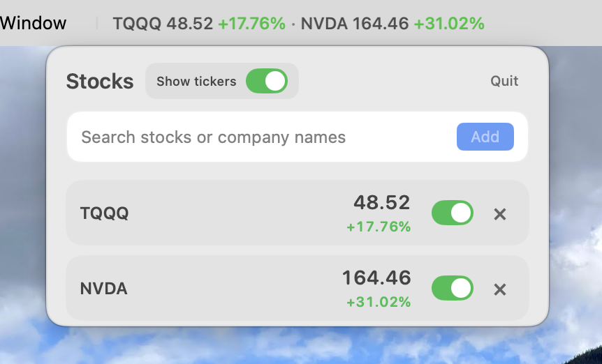

# StockBar

StockBar is a native macOS menu bar app for keeping an eye on stock and ETF prices.

## Open in Xcode

1. Open `StockBar.xcodeproj` in Xcode.
2. Select the **StockBar** scheme and press **Run**.

StockBar supports macOS 13 and later. It runs as a menu bar app without a Dock icon and starts with an empty watchlist.

## Manage tickers

Click StockBar's text in the menu bar to see your watchlist. Use the search field to filter by ticker or company name. Enter one or more symbols in the field at the bottom, separated by commas or spaces, then press **Return** or click **Add**. Click **Remove** beside a symbol to remove it. Your watchlist is saved on this Mac.

Prices arrive in real time through Yahoo Finance's live stream, display to two decimal places, and include a color-coded percentage change. Prices have no currency label, and no API key is required.

## Opening a GitHub release

Release builds are ad-hoc signed and are not notarized. After dragging `StockBar.app` from the disk image to Applications, Control-click the app and choose **Open**, then confirm **Open** again. This is a one-time macOS approval for this app. Apple documents this Gatekeeper override under [Safely open apps on your Mac](https://support.apple.com/en-us/102445).
